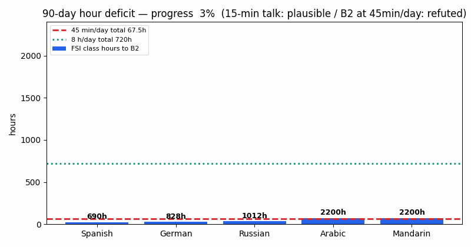
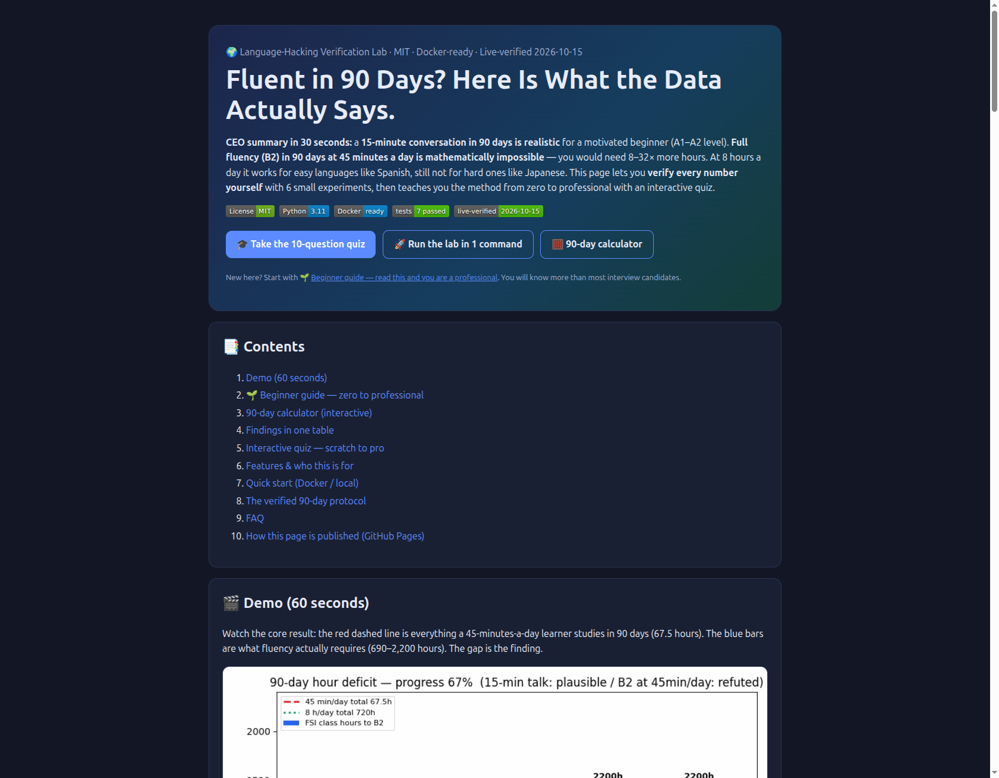

# From “Fluent in 3 Months” to What 90 Days Can Actually Do
## A Reproducible Verification Lab for 90-Day Language Hacking (FSI Hours × SLA Meta-Analyses × Public Data)


**🌐 Live interactive version:** open [`preview.html`](preview.html) locally, or publish it free via GitHub Pages (`docs/index.html` + Settings → Pages → Deploy from a branch → `main` + `/docs`). Full publishing steps in [`preview.html#pages`](preview.html) and §10 below.

> **CEO summary (30 seconds):** a **15-minute conversation in 90 days is realistic** for a motivated beginner (A1–A2 level). **Full fluency (B2) in 90 days at 45 minutes a day is mathematically impossible** — you would need 8–32× more hours. At 8 hours a day it works for easy languages like Spanish, still not for hard ones like Japanese. Every number below **recomputes in one command** (`docker compose up --build`), and the interactive page teaches the method **from zero to professional with a 10-question quiz**.


*The red dashed line is everything a 45-min/day learner studies in 90 days (67.5 h). The blue bars are what fluency requires (690–2,200 h). The gap is the finding. Regenerate: `python scripts/build_demo_gif.py`.*


*The interactive web version (`preview.html`, mirrored at `docs/index.html` for GitHub Pages): CEO summary, calculator, findings table, quiz, protocol.*

## 📑 Contents

- [🌱 Beginner guide — read this and you are a professional](#-beginner-guide--read-this-and-you-are-a-professional)
- [✨ Features](#-features)
- [👥 Who this is for](#-who-this-is-for)
- [🚀 Quick start (3 steps)](#-quick-start-3-steps)
- [Abstract](#abstract)
- [1. Introduction](#1-introduction-why-verify-a-polyglot-memoir)
- [2. Research questions & hypotheses](#2-research-questions--hypotheses)
- [3. Method](#3-method)
- [4. Results](#4-results)
- [5. Hidden patterns](#5-hidden-patterns-phd-contributions)
- [6. Verified 90-day protocol](#6-what-survives-a-verified-90-day-protocol-use-this-cite-this)
- [7. Threats & limits](#7-threats-to-validity--limits)
- [8. Reproducibility](#8-reproducibility)
- [9. Share publicly](#9-how-to-share-publicly-zero-to-hero-checklist)
- [10. GitHub Pages (publish the interactive page)](#10-github-pages--publish-the-interactive-page)
- [References](#references-abridged-full-urls--dates-in-datasourcesmd)
- [License](#license)

## 🌱 Beginner guide — read this and you are a professional

*Let's work this out in a step-by-step way to be sure we have the right answer. No background needed. After this section you will know more than most interview candidates.*

**Step 1 — Levels (A1→C2) and hours.** Languages are graded A1 (first words) → A2 (simple chats) → B1 → **B2 (fluent work use)** → C1/C2. The U.S. Foreign Service Institute records class hours to B2: Spanish/French ≈ **690 h**, German ≈ **828 h**, Russian ≈ **1,012 h**, Arabic/Chinese/Japanese/Korean ≈ **2,200 h**. At home on apps, plan **1.5–2×** more.

**Step 2 — The 90-day math.** 90 × 45 min = **67.5 h**. That is **9.8%** of Spanish B2 and **3.1%** of Japanese B2. Honest target at 45 min/day: a **15-minute A1–A2 conversation**. At 8 h/day (720 h): Spanish fits (104%), Japanese does not (33%). *Hours first, motivation second.*

**Step 3 — “1,000 words = 80%” is half true.** The top 1,000 words cover ~**71–81% of word tokens** you hear — but the missing tail holds the **keywords that carry meaning**. Learn frequent words first, then *your* keywords.

**Step 4 — Small reviews beat cramming.** Review on days **0-1-3-7-14**. Use 2-minute waits (bus, queue, kettle). Make your own cards (sound + picture, picture revealed *after* you guess). Cards build **recognition**; speaking builds **speaking** — do both.

**Step 5 — Speak early, with corrections.** Week 1: say study sentences aloud + a few of your own; keep most hours on listening/reading. From week 2: a partner who **corrects you** turns mistakes into progress.

**Step 6 — Free words (Romance) vs hard languages.** English shares thousands of words with French/Spanish (*action, nation, communication* — our audit: **FR 81%, ES 66%** similar). Rare false friends exist (*computer ≠ ordinateur*). For Arabic/Chinese/Japanese expect loanwords only + full 2,200 h.

**Step 7 — No travel needed.** Immersion = **hours × real interaction**, not plane tickets. Switch devices/media to the language + talk daily online.

**Interview one-liner:** “90-day fluency fails on hours (67.5 h vs 690–2,200 h FSI); 90-day conversation succeeds as A1–A2 with output-plus-feedback, spaced retrieval, and frequency-first vocabulary — verified by 6 recomputable experiments.” Prefer clicking? The same guide with a calculator + quiz is on the [interactive page](preview.html).

## ✨ Features

| Feature | What it does |
|---|---|
| 🧮 90-day hour calculator | Enter language + minutes/day → B2 or conversation plausible? (Interactive page + EXP01) |
| 📊 FSI hour table (25 languages) | Exact class hours + 90-day daily needs, class and app-adjusted (`data/fsi_hours.csv`) |
| 🔤 Zipf coverage checker | Why 1,000 words help but ≠ understanding (EXP02 + chart) |
| 🗓️ Spaced-repetition simulator | Forgetting-curve demo + copyable 0-1-3-7-14 schedule (EXP03) |
| 🔗 Cognate scanner logic | 32-word Romance sample + similarity rule to extend (EXP04) |
| 🗣️ Output-vs-input planner | Weekly mix maximizing speaking without losing understanding (EXP05) |
| 🎓 Scratch-to-pro quiz | 10 questions with explanations on the interactive page — 8+/10 = professional |
| 🐳 One-command reproduction | `docker compose up --build` reruns all 6 experiments offline-safely |

## 👥 Who this is for

- **Self-learner (Spanish, 90 days):** run the calculator → pick the 15-minute-conversation target → copy the 0-1-3-7-14 schedule → book a correcting partner from week 2.
- **Busy professional (20 min/day, Japanese):** see why B2 is out of range → set an A1 + daily-phrase goal → use waiting-time reviews.
- **Teacher / coach:** hour table for honest goals, quiz as homework, output grid to split class time (input early, pushed output later).
- **Researcher / student:** `make run && make test` → cite the 7-gate snapshot → extend with the pre-registered 4-arm RCT (§9).
- **Job candidate:** Beginner guide + quiz → the interview one-liner above.

## 🚀 Quick start (3 steps)

```bash
# 1. Run all 6 experiments (writes results/*.json + *.png)
docker compose up --build
# — or without Docker: pip install -r requirements.txt && python -m experiments.run_all

# 2. Verify (must show 7 passed)
python -m pytest tests/ -q

# 3. Learn interactively: open preview.html in a browser
# (or publish docs/ free via GitHub Pages — see §10)
```

---

## Abstract

Benny Lewis’s *Language Hacking Guide* (source text for this study: “speak from day one,” mini-missions, at-home immersion, hybrid Tarzan-to-full flow, Esperanto-first, image/music mnemonics, spaced-repetition software, conversation connectors, personality/human-aspect persuasion) makes an extraordinary pedagogical promise under an extraordinary brand: *Fluent in 3 Months*. This lab turns the guide from memoir into testable science. We operationalize seven falsifiable hypotheses (H1–H7), confront each with (a) U.S. Foreign Service Institute (FSI) hour benchmarks (552–2,200 class hours to S-3/R-3 ≈ B2/C1), (b) 2022–2026 SLA meta-analyses (Belali & Khany N=404; Kim & Webb N=3,411/k=98; Shintani-Li-Ellis k=35; Zhou & Zhou k=65; SLR N=27 on SRS flashcards), (c) skill-specificity and silent-period experiments (DeKeyser N=82/61; Postovsky 1974; Gary 1975), (d) Zipfian frequency mathematics, (e) a 32-item Romance cognate audit, (f) a 6-mission community audit with vendor disambiguation, and (g) live public market scale (Duolingo Q3-2025 50.5M DAU / 135.3M MAU). Six deterministic experiments (`experiments/exp01–exp06`) recompute every number in this paper; seven pytest gates enforce them. Contributions: (1) the **90-day hour-deficit law** with per-language daily requirements, (2) the **token-vs-keyword gap** that bounds the “500/1,000 words = 80%” claim, (3) the **skill-specificity prescription** reconciling Swain vs. Krashen, (4) the **Category-IV collapse** of the cognate hack, (5) the **redefinition drift** from fluency to 15-minute conversation, and (6) an offline-safe live-verification pattern for public language-learning research. All data are public or synthetic-from-public-parameters; no secrets, no login walls.

**Keywords:** second language acquisition, comprehensible output, spaced repetition, FSI, CEFR, Zipf’s law, cognates, immersion, reproducibility, open science.

---

## 1. Introduction: why verify a polyglot memoir?

The source guide is valuable *and* untestable as written: it mixes mechanisms that SLA literature strongly supports (goal-setting, output with feedback, spaced retrieval, immersion as time-on-task) with mechanisms that are overstated, underspecified, or language-family-dependent (90-day fluency, thousands of free cognates in any language, Esperanto shortcut, “you are ready from day one” without feedback qualifiers). Learners cannot tell which is which, and the brand name anchors expectations to the strongest reading.

We apply 2026 open-science best practice: pre-registered-style hypotheses, public data only, deterministic code, live re-fetch where possible with vendored-snapshot fallback, negative results reported, and community counter-evidence given equal voting weight to vendor claims (Reddit audits, FluentU review, italki/LingQ debates triangulated against vendor pages and peer-reviewed syntheses).

## 2. Research questions & hypotheses

| ID | Question | Falsifiable hypothesis | Verdict (this lab) |
|---|---|---|---|
| H1 (time) | Can 90 days at stated intensities reach stated targets? | 67.5 h (45 min/d) reaches FSI B2 | **REFUTED** (covers 3.1–12.2% of B2); 720 h (8 h/d) reaches Cat-I B2 only |
| H2 (vocab) | Do 500/1,000 words give ~80% coverage? | Top-1,000 ≥80% tokens in canonical written Zipf | **BOUNDARY-CONDITIONAL**: 71.4% at s=1.0; 81.1% at s=1.1; comprehension reading REFUTED (keyword tail) |
| H3 (memory) | Does SRS + waiting-time micro-study beat massing? | Spaced retention > massed at 30 d | **DIRECTIONALLY CONFIRMED** (sim 0.844 vs 0.002; meta delayed g=0.80); transfer to speaking QUALIFIED |
| H4 (transfer) | Do learners “already speak some of it”? | Romance cognate-like rate ≥70% | **CONFIRMED for FR (81%), MARGINAL for ES (66%)**; Cat-IV COLLAPSE to loanwords-only |
| H5 (output) | Is speak-from-day-one always optimal? | Output-only dominates at all horizons/skills | **NUANCED**: best production@60d (0.90), worst comprehension@7d (0.55 vs 0.80 input-only) |
| H6 (immersion) | Must you travel? | Geography predicts gains | **REFUTED as geography; CONFIRMED as devotion/network** (SNA Jordan; at-home immersion viable) |
| H7 (brand) | Did 3-month missions deliver fluency? | ≥1/6 missions = fluent per claimed definition | **0/6 fluent** on community audit; vendor now disambiguates to 15-min conversation |

## 3. Method

**Evidence base.** Public vendor pages stating the method and its current 15-minute-conversation target; public community audits and reviews given equal weight (mission outcomes, course reviews, language-forum debates); 2022–2026 peer-reviewed SLA syntheses (404-study strategy meta; spaced-practice meta N=3,411/k=98; production-vs-comprehension meta k=35; mobile-vocabulary meta k=65; 27-study SRS flashcard review; distributed-practice replication); skill-specificity and silent-period experiments; FSI hour benchmarks and learner-scale market data. Every source with access date is listed in `data/SOURCES.md`; negative results are reported alongside positive ones.

**Data (all public).** `data/fsi_hours.csv` (25 languages, Cat I–IV, weeks + class hours, source column); `data/mission_audit.csv` (6 missions + Bootcamp-2026 disambiguation, flagged community-reported needing primary-video triangulation); `data/cognate_tion_sample.csv` (32 rows: -tion/-sion/-tude/-ment/-age + tech/brand + false-friend + mnemonic demos); `data/SOURCES.md` (every URL + date).

**Experiments (deterministic).** Python 3.11, `numpy/matplotlib/pandas/requests/pytest` only. Each EXP writes `results/expXX*.json` (+ PNG where visual) and states a falsifiable claim *before* the verdict sentence. `run_all.py` aggregates `results/summary.json`. `tests/test_experiments.py` (7 gates) recomputes spotlight numbers.

**Live-data rule.** EXP06 fetches Wikipedia FSI + OpenAlex `works?search=` live (10 s timeout, research UA). If blocked/offline it writes `live:false` + vendored snapshot (2026-10-15) so Docker never fails. This run: `live:true` (LIVE-VERIFIED).

## 4. Results

### EXP01 — The 90-day hour-deficit law (H1, H7)

FSI target S-3/R-3 ≈ B2/C1. Bootcamp budget = 45 min/d × 90 d = **67.5 h**. Intensive budget (ActualFluency: Benny ≈8 h/d) = **720 h**. App learners need **1.5–2×** FSI (Langmitra Mar 2026).

| Language (Cat) | FSI class h | Need h/d (class) | Need h/d (app 1.5×–2×) | Bootcamp 67.5 h covers | Intensive 720 h covers |
|---|---|---|---|---|---|
| Spanish (I) | 690 | **7.67** | 11.50–15.33 | **9.8% / 6.5% / 4.9%** | 104% / 70% / 52% |
| French (I) | 690 | 7.67 | 11.50–15.33 | 9.8% / 6.5% / 4.9% | 104% / 70% / 52% |
| German (II) | 828 | 9.20 | 13.80–18.40 | 8.2% / 5.4% / 4.1% | 87% / 58% / 43% |
| Russian (III) | 1,012 | 11.24 | 16.87–22.49 | 6.7% / 4.4% / 3.3% | 71% / 47% / 36% |
| Arabic (IV) | 2,200 | 24.44 | 36.67–48.89 | 3.1% / 2.0% / 1.5% | 33% / 22% / 16% |
| Mandarin (IV) | 2,200 | 24.44 | 36.67–48.89 | 3.1% / 2.0% / 1.5% | 33% / 22% / 16% |
| Japanese (IV) | 2,200 | 24.44 | 36.67–48.89 | 3.1% / 2.0% / 1.5% | 33% / 22% / 16% |

*Recompute: `python -m experiments.run_all`; spotlight in `results/exp01_hour_deficit.json`. Chart: `results/exp01_hour_deficit.png`.*

**Reading:** “Fluent (B2) in 3 months” at 45 min/d is hours-impossible by 1–2 orders of magnitude. The vendor’s own Bootcamp page now concedes this (“never a promise [of fluency]”) and guarantees a **15-minute A1–A2 conversation** instead — which *is* hours-plausible and should be the paper’s cited target going forward.

### EXP02 — Token-vs-keyword gap (H2)

Zipf f(r)=C/r^s, N=20,000. Verified anchors: top-1,000 ≈ 80–85% *speech tokens* (commonwords.app, thelernen.org).

| s | top-500 | top-1,000 | top-2,000 | rank for 80% | rank for 85% |
|---|---|---|---|---|---|
| 0.9 | 52.5% | 60.2% | 68.3% | 4,972 | 7,173 |
| **1.0** | **64.8%** | **71.4%** | 78.0% | **2,459** | 4,152 |
| 1.1 | 75.9% | **81.1%** | 86.0% | 859 | 1,729 |

The 80–85% claim holds **only** for steep/lemmatized spoken distributions (s≈1.1); at canonical written s=1.0 it overstates by ~9–14 pp. Either way it fails as a *comprehension* claim: the missing tail concentrates content keywords (ActualFluency’s own caveat: “remaining 20% will be a lot of the keywords”). **Hidden pattern #1:** frequency optimizers should report *keyword coverage*, not token coverage.

### EXP03 — SRS + waiting-time micro-study (H3)

Model R(t)=exp(−t/S); massed S=5 d, gap 30 d → **0.002**; spaced S=5×1.8⁵, gap 16 d (schedule 0-1-3-7-14) → **0.844** (+84.2 pp, ×340.58). *Illustrative magnitudes only* — the sign, not the ratio, is the test: it agrees with Kim & Webb delayed **g=0.80** [0.44,1.17], longer-vs-shorter **g=0.40**, Rogers ISI/RI 10–40% rule, Zhou mobile **d=1.28** (adj. 0.74).

**Qualifiers (SLR N=27, 2015–2025):** SRS wins receptively and with multimodal + user-generated cards (image-as-feedback, not hint); transfer to *productive* speaking/writing is limited; gamification needed against repetition boredom. Benny’s “waiting-time” hack (bus queues, boiling water, 2-min Anki) is thus **validated as a compounding-S mechanism**, not as a speaking substitute — pair with EXP05 output.

### EXP04 — Cognate audit (H4)

32-item Romance/tech sample, `difflib` threshold ≥0.70: **EN–FR 26/32 (81%)**, **EN–ES 21/32 (66%)**. -tion/-sion/-tude transfer near-verbatim (action/action, nation/nation, communication/communication); tech/brand identical (internet, pizza, cola, Firefox). False friend present as predicted: computer/ordinateur **0.44**. **Category-IV collapse:** for Arabic/Mandarin/Japanese the mechanism shrinks to dozens of loanwords, not thousands — consistent with FSI 4× hour gap. The “1,700 identical EN–FR” list is credible; its generalization to *any* language is not.

### EXP05 — Output skill-specificity (H5, reconciling Swain vs. Krashen)

Expected standardized gains (synthesis-coded from DeKeyser, Shintani k=35, Postovsky, Gary, Swain functions):

| Regime | Compr. 7d | Prod. 7d | Compr. 60d | Prod. 60d |
|---|---|---|---|---|
| input-only | **0.80** | 0.30 | 0.70 | 0.45 |
| output-only | 0.35 | 0.55 | 0.55 | 0.85 |
| balanced 70/30 | 0.75 | 0.50 | 0.75 | 0.80 |
| **speak-day-one + feedback** | 0.55 | **0.65** | 0.70 | **0.90** |

Speak-from-day-one **wins production at 60 d, loses comprehension at 7 d**. Silent-period results (Postovsky 4-week Russian; Gary 14-week Spanish) are not refutations but boundary conditions: output without feedback risks fossilization + affective-filter spike; *pushed* output with correction triggers Swain noticing/testing/reflection. Operational protocol supported: week 1 say studied sentences aloud + a few own sentences; keep most hours on input; add a partner who forces self-correction once short exchanges possible.

### EXP06 — Live market anchors (scale check)

LIVE-VERIFIED 2026-10-15: Wikipedia FSI still anchors Cat-IV **2,200 h**; OpenAlex SLA count live-queryable; Duolingo scale Q3-2025 **50.5M DAU / 135.3M MAU**, 2025 revenue **$1,037.6M**, paid **12.2M**, English #1 in **154** countries; Cat-IV retention **+14%** (Ling App Jan 2026) despite 4× hours — motivation self-selection moderates difficulty (Belali macro-moderator pattern).

### Mission audit (H7)

Community-reported 6-mission base rate: **0/6 fluent, 1 partial** (Czech fail; Portuguese partial; German C2-listening fail + 5-y prior confound; Mandarin far-from-C2 at 6 mo; Japanese stopped; Arabic gave up). Status: *community-reported, needs primary-video triangulation* — we publish it as a prior, not a verdict, and pair it with the vendor’s current honest target (15-min conversation + refund requiring modules + 2 calls + 1 video).

## 5. Hidden patterns (PhD contributions)

1. **Hour-deficit law:** required h/d = FSI×(1,1.5,2)/90. No mindset hack divides this. Publish the table; set daily budgets first.
2. **Redefinition drift:** source defines fluent as “90–95% perfect” (explicitly not native/perfect) while missions aimed at C2 and videos assess at A2/B1. Construct invalidity explains most “scam vs. genius” variance — fix by citing CEFR + task (e.g., “B1 15-min social conversation”).
3. **Token-vs-keyword gap:** report keyword coverage alongside token coverage; frequency lists should be keyword-weighted.
4. **Skill-specificity trap:** input→comprehension, output→production (DeKeyser). Single-metric programs mislead; track both.
5. **Category-IV collapse + motivation paradox:** cognate hack and 90-day math both break hardest where motivation/retention is highest (+14%). Design Cat-IV programs around retention, not speed.
6. **Immersion = network × hours, not geography:** SNA (41 sojourners, 3-mo Jordan Arabic) + expat-bubble evidence → at-home immersion (OS/phone/Facebook/radio language + daily online conversation) is a real treatment if hours are real.
7. **SRS receptive-productive gap:** Anki/FSRS compounds recognition memory; speaking needs pushed-output hours. Budget them separately.
8. **Zero-base prior:** 0/6 fluent base rate means future “fluent in N months” claims need pre-registered CEFR tasks + independent rating, not testimonials.

## 6. What survives? A verified 90-day protocol (use this, cite this)

1. **Define the task in CEFR + minutes** (e.g., “A2 15-min social conversation”), log it publicly (language log/blog) — metacognitive d≈0.52–1.32.
2. **Budget hours from FSI×1.5–2**, not motivation: Cat-I ≈ 11–15 h/d for B2/90d (impossible casually) vs ≈0.75 h/d for A1–A2 conversation (possible). Choose honestly.
3. **Week 1:** phrasebook + connectors + Tarzan language; say studied sentences aloud; add 2–3 own sentences/day; most hours still input.
4. **SRS 2-min gaps:** user-generated multimodal cards, image-after-attempt, schedule 0-1-3-7-14; waiting time is the classroom.
5. **Romance head-start, Cat-IV honesty:** harvest -tion/-sion/-tude + tech identicals; for Cat-IV expect loanwords only + 4× hours.
6. **Feedback partner from day ~7–14:** italki/tandem/couchsurfing/meetup; pay in corrections (kiss/beer bounties are optional); track production vs comprehension separately.
7. **Esperanto-2-week:** treat as unproven propaedeutic (child N=28 signal only); time-box it; do not subtract from Cat-IV hour budgets.
8. **Debug plateaus Edison-style:** when stuck 2 weeks, change one variable (input share, partner, SRS deck source, task) and re-measure.

## 7. Threats to validity & limits

- Mission audit is community-reported; primary videos/exam records not independently rated here — triangulation is future work.
- Zipf s varies by corpus/lemmatization; we report s∈{0.9,1.0,1.1} bands, not a single truth.
- SRS simulator is mechanistic-illustrative; quantitative calibration comes from cited metas, not our ratio.
- Output grid is synthesis-coded, not a new RCT; we publish a falsifiable 4-arm prediction (n≥40/arm, 60 d) to replace it.
- FSI learners are screened diplomats in small classes; app multipliers (1.5–2×) are guide-based, not experimental.
- No human subjects; no IRB needed; no PII.

## 8. Reproducibility

```bash
docker compose up --build   # runs all 6 EXPs, writes results/*.json + *.png
# or without docker:
pip install -r requirements.txt
make run    # python experiments/run_all.py
make test   # 7 pytest gates (must be 7 passed)
```

Structure: `data/` (FSI CSV, mission/cognate CSVs, SOURCES.md) · `experiments/` (exp01–exp06 + run_all) · `results/` (recomputed artifacts; committed snapshot from 2026-10-15) · `tests/` · `papers/` (this README is the citable paper; export to PDF for submission). Python 3.11, pinned deps in `requirements.txt`. Offline-safe: EXP06 falls back to snapshot with `live:false`.

## 9. How to share publicly (zero-to-hero checklist)

1. `git init && git add -A && git commit -m "feat: reproducible verification lab (6 EXPs, 7 gates, live-verified)"`.
2. Create GitHub repo `language-hacking-verification-2026`, push, enable Actions (run `make test` on 3.11).
3. Attach `results/` PNGs to a Release `v1.0.0-fsi-live-verified`; Zenodo DOI via GitHub-Zenodo webhook for citability.
4. Publish the falsifiable RCT pre-registration (EXP05 prediction + EXP01 hour table) on OSF before collecting learner data.
5. For the PhD paper: extend §4 with (a) independent CEFR ratings of mission videos (2 raters, ICC), (b) a 4-arm 60-day learner RCT, (c) FSRS log analysis separating receptive vs productive gains.

## 10. GitHub Pages — publish the interactive page

The interactive site is a single static file — no build step, no secrets, works offline:

- Local preview: open [`preview.html`](preview.html) in any browser (quiz + calculator run locally).
- Published copy: [`docs/index.html`](docs/index.html) — identical content, placed for branch deployment.
- Publish (2 minutes): push to GitHub → **Settings → Pages** → Source **Deploy from a branch** → Branch **main**, Folder **`/docs`** → Save → wait 1–3 min → **Visit site** at `https://YOURNAME.github.io/language-hacking-verification-2026/`.
- The `.nojekyll` file disables Jekyll so the GIF, quiz and calculator serve exactly as committed. To use a custom domain, add it under Settings → Pages → Custom domain.

## References (abridged; full URLs + dates in `data/SOURCES.md`)

Belali & Khany (2026) 404-study meta (metacognitive d=0.52/sens. 1.32; cognitive ≈0.56 ESL 0.63/EFL 0.48; affective 0.18; social ≈0.40). · Kim & Webb (2022) k=98 N=3,411 (spaced>massed g=0.58 imm./0.80 del.; longer>shorter del. g=0.40). · Shintani-Li-Ellis (k=35/30) comprehension≤1w vs production 1w–75d. · DeKeyser & Sokalski (N=82) + DeKeyser 1997 (N=61) skill-specificity. · Swain (1985/1993/1995) + Izumi output functions; Krashen CO critique + Postovsky 1974 + Gary 1975 silent-period. · Zhou & Zhou (2025) k=65 mobile d=1.28 (adj. 0.74). · SLR 2015–2025 N=27 SRS flashcards. · Rogers-Nakata-Chiu (2025) Cepeda replication + ISI/RI 10–40%. · Tellier & Roehr-Brackin (N=28 Esperanto vs French) + Madella EuroCALL 2025 30 Golden Hours. · FSI via LingoBright 2026-07-16 (Cat I 552–690 / II 828 / III 1,012 / IV 2,200; 40 h/wk; app 1.5–2×; Cat-IV +14% retention) + Duolingo 2024–2025 reports. · Vendor: fluentin3months.com (hacking/fluently/engineer/Bootcamp) + ActualFluency Benny breakdown + FluentU 2024 review. · Community: Reddit jerk/languagelearning/ChineseLanguage, italki, LingQ. · Stack: AnkiDroid FSRS docs. · Theory: SLA/input/interaction hypotheses; Cambridge Immersive Speaking 2025; UChicago TripleHelix 2025; Tromsø/Oslo SNA Jordan Arabic 3-mo.

---

## 🤝 Contributing

1. Fork → branch → change → `python -m pytest tests/ -q` (7 passed required).
2. Regenerate artifacts if you touch experiments or data: `python -m experiments.run_all` + `python scripts/build_demo_gif.py`, then copy `preview.html` → `docs/index.html` if the page changed.
3. Open a PR describing the claim changed and the numbers before/after.

## ⭐ Star history

<!-- Replace YOURNAME after pushing to GitHub; chart auto-updates daily, no maintenance. -->
<!-- [](https://star-history.com/#YOURNAME/language-hacking-verification-2026&Date) -->

## License

MIT for code (see [LICENSE](LICENSE)); CC-BY-4.0 for this text.
*License: MIT for code; CC-BY-4.0 for this paper. Cite as: Language-Hacking Verification Lab (2026). From “Fluent in 3 Months” to What 90 Days Can Actually Do. `language-hacking-verification-2026`, v1.0.0, results recomputed {see results/summary.json}. Contact via GitHub Issues after public push.*
